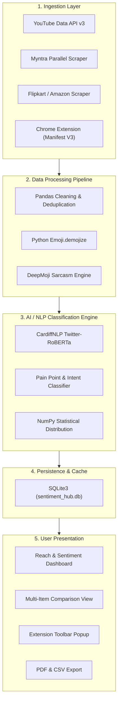

# 🚀 Sociafy AI — Real-Time Social Media & E-Commerce Sentiment Intelligence Platform

[](https://fastapi.tiangolo.com/)
[](https://react.dev/)
[](https://tailwindcss.com/)
[](https://huggingface.co/cardiffnlp/twitter-roberta-base-sentiment-latest)
[](https://developer.chrome.com/docs/extensions/mv3/)
[](https://opensource.org/licenses/MIT)

**Sociafy AI** is an enterprise-grade, full-stack intelligence platform that scrapes, cleans, and analyzes audience comments and customer reviews across **YouTube, Instagram, Amazon, Myntra, Flipkart, Meesho, Nykaa, and Ajio** in real time.

It features **Head-to-Head Multi-Item Comparison**, **Automated #1 Winner Selection**, **Deep NLP Sentiment Classification**, **Pain Point Identification**, and a **Chrome Extension (Manifest V3)** for instant one-click analysis right from any product or video page.

---

## 📑 Table of Contents

- [Key Capabilities](#-key-capabilities)
- [Supported Platforms](#-supported-platforms)
- [Multi-Item Comparison & Winner Engine](#-multi-item-comparison--winner-engine)
- [AI Scoring Methodology](#-ai-scoring-methodology)
- [System Architecture](#-system-architecture)
- [Technology Stack](#-technology-stack)
- [Quick Start & Installation](#-quick-start--installation)
  - [1. Backend Setup](#1-backend-setup)
  - [2. Frontend Setup](#2-frontend-setup)
  - [3. Chrome Extension Setup](#3-chrome-extension-setup)
- [API Reference](#-api-reference)
- [Project Directory Structure](#-project-directory-structure)
- [Contributing & License](#-contributing--license)

---

## ✨ Key Capabilities

### 1. Multi-Platform Intelligence Workspaces
- **YouTube Workspace:** Real-time analysis for YouTube Videos and Shorts. Displays total views, engagement likes, subscriber counts, unique audience reach, and full comment threads with pagination.
- **Social Media Workspace:** Automated metrics for Instagram Reels and Posts, including impressions, followers, and engagement rates.
- **E-Commerce Workspace:** Deep review scraping for Amazon, Myntra, Flipkart, Meesho, and Nykaa. Evaluates star ratings, verified buyer badges, and product performance.

### 2. Multi-Item & Multi-Video Comparison Board
- Compare **2 to 5 items side-by-side** simultaneously.
- Compare on real views, likes, verified review counts, positive satisfaction %, and negative complaint ratios.
- Automatically calculates a scientific **AI Quality Score (0–100)** and crowns the **🏆 #1 Overall Winner** with concise verdicts.
- Direct **"View All Comments"** links to open deep sentiment drill-downs for any compared item.

### 3. RoBERTa + DeepMoji NLP Engine
- **CardiffNLP Twitter-RoBERTa-base:** State-of-the-art transformer architecture trained on 124M+ social tweets.
- **DeepMoji 64-Emotion Sarcasm & Irony Matrix:** Detects polarity clashes (e.g., negative complaints paired with happy emojis like `👏`, `🎉`, `🙃`, `🤡`).
- **Hinglish & Multilingual Support:** High-precision evaluation of mixed Hindi-English (`Devanagari` and transliterated roman script).

### 4. Automated Pain Point & Inquiry Categorization
- Automatically tags customer feedback into actionable business categories:
  - 🚚 **Delivery Problems** (Late shipping, courier friction)
  - 💰 **Price Concerns** (Overpriced, value-for-money complaints)
  - 🧵 **Product Quality / Fit Defects** (Sizing issues, material dissatisfaction)
  - 📦 **Packaging / Transit Damage** (Broken seals, crushed boxes)
  - ❓ **Customer Inquiries** (Restock dates, sizing questions, links)

### 5. Distraction-Free Chrome Extension (Manifest V3)
- Instant toolbar popup analysis for any open e-commerce or social media tab.
- Live progress timer counter during fresh review scraping.
- One-click navigation to open the main web dashboard with pre-filtered sentiment (`Positive`, `Negative`, or `All Comments`).
- Completely clean in-page experience with zero intrusive floating buttons or ads.

### 6. Export & Modern UI
- **PDF Report Exporter:** Generates full analytical PDF reports complete with KPI cards, donut graphs, and verified comment previews.
- **CSV Data Export:** One-click download of all cleaned and classified comments.
- **Dark Mode by Default:** Premium dark aesthetic with instant toggle in the header.
- **Collapsible Sidebar:** Streamlined icon-only toggle for maximum screen real estate.

---

## 🌐 Supported Platforms

| Platform | Type | Scraping / Ingestion Method | Extracted Metrics |
| :--- | :--- | :--- | :--- |
| **YouTube** | Videos & Shorts | YouTube Data API v3 (`nextPageToken` while-loop) | Views, Likes, Subscribers, Comments |
| **Instagram** | Posts & Reels | RapidAPI Instagram Scraper + Embed Metadata | Likes, Followers, Reach, Comments |
| **Myntra** | E-Commerce | Multi-threaded Parallel Scraper (`window.__myx`) | Star Ratings, 1000+ Reviews, Likes |
| **Flipkart** | E-Commerce | Headless HTML & JSON Parser | Ratings, Reviews, Buyer Verification |
| **Amazon** | E-Commerce | Universal Scraper + Title Sanitizer | Product Titles, Ratings, Customer Reviews |
| **Universal Web** | Any Store / Blog | Schema.org JSON-LD + Semantic DOM Parser | Titles, Descriptions, Reviews |
| **CSV / Manual** | Custom Data | Direct CSV Upload & Text Parser | Custom Columns, Comments, Timestamps |

---

## ⚖️ Multi-Item Comparison & Winner Engine

The comparison engine allows users to evaluate multiple products or videos to determine the highest quality choice.

```
+---------------------------------------------------------------------------------------+
|  🏆 #1 OVERALL WINNER: Apple iPhone 15 (128 GB)                                        |
|  AI Score: 87.4/100 | Positive: 80% | Complaints: 1.4% | Views: 3,752,295             |
|  Verdict: Highest overall customer satisfaction with minimal hardware complaints.    |
+---------------------------------------------------------------------------------------+
|  [Card 1: iPhone 15]          [Card 2: SASSAFRAS Shrug]        [Card 3: Sangria Lehenga]|
|  Score: 87.4/100 (Rank #1)     Score: 79.9/100 (Rank #2)        Score: 78.5/100 (Rank #3)|
|  Pos: 80% | Neg: 1.4%          Pos: 88% | Neg: 0.0%             Pos: 81% | Neg: 5.2%     |
|  Views: 3.75M | Likes: 9.8K    Views: 6.2K | Likes: 139         Views: 6.2K | Likes: 122 |
|  Top: Quality / Spec Deal      Top: Sizing / Length Concern     Top: Delivery Problem    |
+---------------------------------------------------------------------------------------+
```

### Features:
- **Instant Quick-Add:** One-click add from historical analyzed items.
- **URL Input Bar:** Paste any supported YouTube or E-Commerce link to scrape and compare on demand.
- **Head-to-Head Matrix Table:** Detailed comparative grid highlighting winners in green badges.

---

## 🧮 AI Scoring Methodology

The platform computes a normalized **AI Quality Score ($0 - 100$)** using a balanced multi-criteria algorithm:

$$\text{AI Quality Score} = (P \times 0.50) + E_{\text{factor}} + ((100 - N) \times 0.30)$$

Where:
- **$P$ (Positive Satisfaction, 50% Weight):** Direct percentage of positive audience sentiment.
- **$N$ (Negative Penalty, 30% Weight):** Complaint ratio deduction. Products with high defect or late shipping rates are penalized.
- **$E_{\text{factor}}$ (Engagement Factor, up to 20 Points):** Logarithmic like & view score rewarding high audience interaction:
  $$E_{\text{factor}} = \min\left(20,\, \log_{10}(\max(10,\, \text{likes})) \times 4.5\right)$$

Scores are bounded between $10.0$ and $99.5$ to ensure realistic and statistically sound comparisons.

---

## 🏗️ System Architecture



---

## 🛠️ Technology Stack

### Backend
- **Python 3.10+**
- **FastAPI:** High-performance async web framework.
- **Uvicorn:** Production ASGI web server.
- **Pandas & NumPy:** Data cleaning, vectorization, and statistical metric computation.
- **CardiffNLP RoBERTa:** HuggingFace transformer pipeline for sentiment scoring.
- **Requests & BeautifulSoup4:** Fast web scraping and review extraction.
- **SQLite3:** Local zero-configuration database for instant cached queries.

### Frontend
- **React 18 & Vite:** Lightning-fast single-page application framework.
- **Tailwind CSS:** Utility-first styling with native dark mode support.
- **Recharts:** Responsive SVG donut charts and trend lines.
- **Lucide React:** Modern, lightweight icon system.

### Chrome Extension
- **Manifest V3:** Adheres to Google's latest security, performance, and privacy standards.
- **Background Service Worker:** Asynchronous API proxy with a 60-second timeout.
- **Clean Content Script:** Distraction-free DOM parser with zero injected elements.

---

## 🚀 Quick Start & Installation

### Prerequisites
- **Python 3.10** or higher installed.
- **Node.js 18** or higher installed.
- **Google Chrome** or any Chromium-based browser (Edge, Brave).

---

### 1. Backend Setup

```bash
# Navigate to the backend directory
cd backend

# Create and activate a virtual environment (optional but recommended)
python -m venv venv
# Windows:
venv\Scripts\activate
# macOS/Linux:
source venv/bin/activate

# Install required dependencies
pip install -r requirements.txt

# Start the backend server
python -m uvicorn main:app --host 0.0.0.0 --port 8000 --reload
```

The backend API will be available at: **`http://localhost:8000`**  
Interactive Swagger API documentation: **`http://localhost:8000/docs`**

---

### 2. Frontend Setup

```bash
# Open a new terminal and navigate to the frontend directory
cd frontend

# Install dependencies
npm install

# Start the Vite development server
npm run dev
```

The web dashboard will be available at: **`http://localhost:5173`**

---

### 3. Chrome Extension Setup

1. Open **Google Chrome** and navigate to:
   ```
   chrome://extensions
   ```
2. Enable **"Developer mode"** in the top-right corner.
3. Click the **"Load unpacked"** button in the top-left corner.
4. Select the `extension` folder located inside the repository:
   ```
   Social Media Hub/extension
   ```
5. **Done!** Pin the **Sociafy AI** icon to your Chrome toolbar.
6. Open any YouTube video or product on Amazon/Myntra/Flipkart and click the extension icon to see instant sentiment analysis!

---

## 📡 API Reference

### 1. `POST /api/analyze`
Scrapes and analyzes any social media post or e-commerce product URL.

**Request Body:**
```json
{
  "platform": "flipkart",
  "post_url": "https://www.myntra.com/shrug/sassafras/.../buy",
  "max_comments": 1000
}
```

**Response (Sample):**
```json
{
  "id": "e492b45e-d21",
  "platform": "flipkart",
  "post_title": "SASSAFRAS — Navy Blue Self Design Longline Shrug",
  "total_comments": 139,
  "sentiment_breakdown": {
    "positive_pct": 88.0,
    "negative_pct": 0.0,
    "neutral_pct": 12.0
  },
  "top_keywords": [
    { "word": "good", "count": 50, "dominant_sentiment": "Positive" },
    { "word": "quality", "count": 16, "dominant_sentiment": "Positive" }
  ],
  "pain_points": [
    { "category": "Quantity / Sizing Issue", "severity": "Medium", "mentions": 4 }
  ]
}
```

---

### 2. `POST /api/compare`
Compares 2 to 5 items and automatically ranks them to determine the #1 Winner.

**Request Body:**
```json
[
  { "post_url": "https://www.flipkart.com/apple-iphone-15-black-128-gb/p/itm6ac6485515ae4", "platform": "flipkart" },
  { "post_url": "https://www.myntra.com/shrug/sassafras/.../buy", "platform": "flipkart" }
]
```

**Response (Sample):**
```json
{
  "total_compared": 2,
  "winner_id": "a43115a4-f39",
  "winner_title": "Apple iPhone 15 Black 128 GB",
  "ai_verdict_summary": "Apple iPhone 15 Black 128 GB ranks #1 with an AI Quality Score of 87.4/100...",
  "items": [
    {
      "rank": 1,
      "is_winner": true,
      "ai_score": 87.4,
      "badge": "🏆 #1 Best Choice",
      "positive_pct": 79.7,
      "negative_pct": 1.4
    },
    {
      "rank": 2,
      "is_winner": false,
      "ai_score": 79.9,
      "badge": "Rank #2",
      "positive_pct": 88.0,
      "negative_pct": 0.0
    }
  ]
}
```

---

### 3. `GET /api/health`
Returns system status, active database records, and available NLP backends.

---

## 📁 Project Directory Structure

```
Social Media Hub/
├── backend/
│   ├── main.py                     # FastAPI server & route handlers
│   ├── models.py                   # Pydantic schemas & SQLite persistence layer
│   ├── requirements.txt            # Python dependencies
│   ├── services/
│   │   ├── data_pipeline.py        # Pandas cleaning, deduplication & emoji demojization
│   │   ├── nlp_engine.py           # CardiffNLP RoBERTa + DeepMoji sarcasm matrix
│   │   └── social_fetcher.py       # Multi-platform parallel scraping engine
│   └── sentiment_hub.db            # Local SQLite database
│
├── frontend/
│   ├── index.html                  # HTML entry point (Dark Mode default)
│   ├── package.json                # Frontend package dependencies
│   ├── vite.config.js              # Vite bundler configuration
│   └── src/
│       ├── App.jsx                 # Master application controller & navigation
│       ├── components/
│       │   ├── Sidebar.jsx         # Collapsible SaaS navigation sidebar
│       │   ├── TopBar.jsx          # Header controls (Platform switcher & exports)
│       │   ├── MultiComparisonView.jsx # Multi-item comparison & winner board
│       │   ├── MetricsCards.jsx    # Real reach & sentiment statistics cards
│       │   ├── SentimentDonutChart.jsx # Recharts sentiment donut graph
│       │   ├── LiveInsightsPanel.jsx   # Comments sentiment list & filter tabs
│       │   └── HistoryView.jsx     # Historical analyzed posts explorer
│       └── services/
│           ├── api.js              # Axios/Fetch API client
│           └── pdfExporter.js      # Clean analytical PDF report generator
│
├── extension/
│   ├── manifest.json               # Manifest V3 extension configuration
│   ├── background.js               # Service worker with 60s timeout proxy
│   ├── content.js                  # Lightweight DOM context detector
│   ├── popup.html                  # Extension toolbar popup interface
│   ├── popup.js                    # Popup controller with live timer & caching
│   └── README.md                   # Extension installation guide
│
└── README.md                       # Master project documentation
```

---

## 🤝 Contributing

Contributions, issues, and feature requests are welcome!  
Feel free to check the [issues page](https://github.com/singhruchita47/social-media-analyzer-/issues) if you have ideas or bug reports.

1. Fork the Project.
2. Create your Feature Branch (`git checkout -b feature/AmazingFeature`).
3. Commit your Changes (`git commit -m 'feat: Add some AmazingFeature'`).
4. Push to the Branch (`git push origin feature/AmazingFeature`).
5. Open a Pull Request.

---

## 📄 License

Distributed under the **MIT License**. See `LICENSE` for more information.
