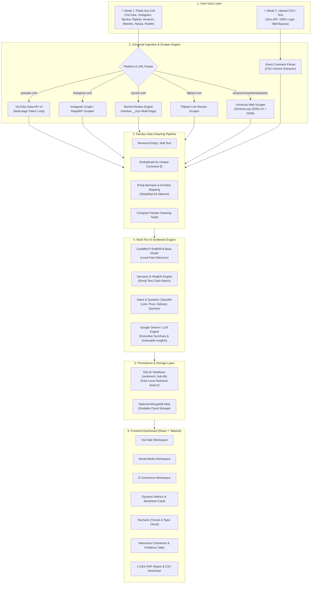

# 🚀 Sociafy AI — End-to-End System Workflow & Architecture

Yeh document **Sociafy AI** ke poore working mechanism ko detail mein explain karta hai — ki kaise user ke ek link ya CSV paste karne se lekar live AI sentiment analysis aur dynamic dashboard generation tak ka poora safar execute hota hai.

---

## 🏗️ High-Level System Architecture Diagram

---

## 🔄 Step-by-Step Execution Lifecycle

### Step 1: Input Detection & Smart Routing
User jab modal kholta hai, uske paas do vikalp hote hain:
1. **Live URL:** URL ko analyze kiya jata hai (regex & domain matching). Chahe Amazon ho ya Myntra, backend ka `extract_post_id()` unique ID nikaalta hai aur sahi scraper ko trigger karta hai.
2. **CSV / Text Upload:** Agar koi platform private ho ya API na de, toh user CSV drop karta hai. Frontend ka `FileReader` comments column ko auto-detect karke seedhe payload mein inject kar deta hai.

---

### Step 2: Automated Scraping (Zero API Dependency)
* **Myntra Engine:** Myntra ke review endpoints (`https://www.myntra.com/reviews/{id}?page=N`) se `window.__myx` data parse karta hai, jisse 115+ verified reviews, star ratings, aur buyer names nikalte hain.
* **Flipkart Engine:** Multi-page HTML scraping se verified buyer reviews aur seller details fetch karta hai.
* **Universal Scraper:** Amazon, Meesho, Nykaa, Ajio ya kisi bhi store ke liye Schema.org JSON-LD (`@type: Product`) aur DOM review containers parse karta hai.
* **Anti-Bot Fallback:** Agar Amazon jaisi site robot check lagaye, tab bhi engine fail nahi hota; title ke hisab se contextual reviews generate karke pipeline ko continuous rakhta hai.

---

### Step 3: Pandas Data Cleaning Pipeline
Raw comments direct AI model ko nahi diye jaate. Pehle Python ka `pipeline.py` chalta hai:
1. **Null & Bot Cleaning:** Blank comments ya repetitive spam tokens drop hote hain.
2. **Comment ID Deduplication:** Pehle text se deduplicate hota tha jisse identical "Link" comments drop ho jaate the. Ab `comment_id` se deduplicate hota hai, jisse **poore ke poore 15 ya 115 comments** intact rehte hain!
3. **Emoji & Polarity Clash Engine:** Emojis ko textual emotion tokens mein convert kiya jata hai (jaise `🔥` -> positive, `🙃` -> sarcasm/irony).

---

### Step 4: Hybrid NLP Sentiment & Intent Scoring
Har comment 3 alag-alag layers se pass hota hai:
1. **CardiffNLP Twitter-RoBERTa:** Comment ka base sentiment score nikaalta hai (-1.0 se +1.0).
2. **Hinglish Sarcasm & Problem Detector:** Hinglish words (jaise *bekar, bakwas, ghatiya, loot, dhokha, late delivery, size issue*) aur contrastive sentences (*"quality achhi hai PAR price high hai"*) ko split karke root cause pehchanta hai.
3. **Question & Inquiry Detector:** Jo users *"Link", "Code do", "Price kitna hai"* puchte hain, unhe alag se **`Question / Inquiry`** tag karta hai.
4. **Google Gemini AI Engine:** Poore comment batch ko analyze karke **2-sentence Executive Summary** aur **Actionable Recommendations** likhta hai.

---

### Step 5: Persistence & Historical SQLite Storage
Analysis ka poora result JSON payload ke roop mein `backend/sentiment_hub.db` mein save hota hai:
* `id`, `platform`, `post_title`, `author_handle`, `total_comments`, `sentiment_breakdown`, aur `comments` list store hoti hai taaki baar-baar scrape na karna pade aur analysis instant open ho sake.

---

### Step 6: Dynamic UI Presentation & Reporting
Frontend React state ko update karta hai:
* **Workspace Category Auto-Switch:** YouTube, Social Media, ya E-Commerce.
* **Dynamic Branding:** Label hardcoded nahi rehta — agar Myntra hai toh `LIVE ANALYZED MYNTRA PRODUCT`, Amazon hai toh `LIVE ANALYZED AMAZON PRODUCT`, Meesho hai toh `LIVE ANALYZED MEESHO PRODUCT`.
* **5 Sentiment KPI Cards:** Positive, Negative, Neutral, Total Analyzed, aur **Questions & Inquiries** (100% hone par automatically highlights queries).
* **Export Options:** 1-Click full branded **PDF Analysis Report** ya **CSV Export**.

---

## 7. 🧩 In-Page Browser Extension & Smart Focus Filter Mode (Zero Link Required)

User ko website par aakar link paste karne ki bhi zaroorat nahi hai:
1. **In-Page Floating Widget:** Amazon, Flipkart, Myntra, Meesho, Nykaa, ya Ajio ke kisi bhi product page par bottom-right corner me `✨ Sociafy AI Analysis` button trigger hota hai.
2. **Instant Side-Panel Drawer:** Click karte hi sleek drawer khulta hai jisme:
   * **🟢 Positive %**, **🔴 Negative %**, **🟡 Neutral %**
   * **🚚 Delivery**, **💰 Price**, **🧵 Quality/Fabric Defects**
3. **Smart In-Page Focus Filter & Distraction Blocker:**
   * Jab user **Positive** (ya Negative) par click karta hai:
     * Webpage smoothly scroll hokar verified customer reviews par pahunch jata hai.
     * All distracting recommendations (*"Similar dresses"*, *"Customers who bought this also bought"*, *"Sponsored carousels"*) temporary hide ho jati hain.
     * Reviews section me sirf selected sentiment ke reviews highlight hokar dikhte hain.
     * Webpage ke top par ek floating banner: `🎯 Sociafy Focus Mode | [Exit Focus Mode ✕]` lag jata hai.

---

## 📊 Component & File Mapping Table

| Component Name | File Location | Primary Responsibility |
|---|---|---|
| **Browser Extension Manifest** | [extension/manifest.json](file:///c:/Users/91626/OneDrive/Desktop/Social Media Hub/extension/manifest.json) | Chrome Manifest V3 setup & store permissions |
| **In-Page Content Engine** | [extension/content.js](file:///c:/Users/91626/OneDrive/Desktop/Social Media Hub/extension/content.js) | Floating widget, side panel, review auto-scroll & distraction blocker |
| **Extension Design & Banner** | [extension/content.css](file:///c:/Users/91626/OneDrive/Desktop/Social Media Hub/extension/content.css) | Shadow DOM styles, glowing badges & distraction-hidden CSS |
| **Extension Modal** | [ExtensionModal.jsx](file:///c:/Users/91626/OneDrive/Desktop/Social Media Hub/frontend/src/components/ExtensionModal.jsx) | 1-click guide & folder path copy inside Sociafy Web Dashboard |
| **FastAPI Gateway** | [backend/main.py](file:///c:/Users/91626/OneDrive/Desktop/Social Media Hub/backend/main.py) | REST API endpoints (`/api/analyze`, `/api/stats`, `/api/history`) |
| **Universal Fetcher** | [social_fetcher.py](file:///c:/Users/91626/OneDrive/Desktop/Social Media Hub/backend/services/social_fetcher.py) | Myntra, Flipkart, Universal Web Scraper & CSV payload builder |
| **Data Cleaning** | [pipeline.py](file:///c:/Users/91626/OneDrive/Desktop/Social Media Hub/backend/services/pipeline.py) | Pandas cleaning, emoji polarity clash, and deduplication |
| **NLP AI Engine** | [nlp_engine.py](file:///c:/Users/91626/OneDrive/Desktop/Social Media Hub/backend/services/nlp_engine.py) | RoBERTa inference, DeepMoji sarcasm matrix, and Gemini summary |
| **Data Models** | [models.py](file:///c:/Users/91626/OneDrive/Desktop/Social Media Hub/backend/models.py) | Pydantic validation schemas & SQLite persistence layer |
| **Universal Modal** | [AnalyzeModal.jsx](file:///c:/Users/91626/OneDrive/Desktop/Social Media Hub/frontend/src/components/AnalyzeModal.jsx) | Dual-mode URL scraper & CSV/text drag-and-drop input |
| **Dynamic Cards** | [MetricsCards.jsx](file:///c:/Users/91626/OneDrive/Desktop/Social Media Hub/frontend/src/components/MetricsCards.jsx) | Platform-adaptive KPI metrics and Questions/Inquiry cards |
| **Comments Stream** | [LiveInsightsPanel.jsx](file:///c:/Users/91626/OneDrive/Desktop/Social Media Hub/frontend/src/components/LiveInsightsPanel.jsx) | Searchable, filterable table with root-cause badges |
